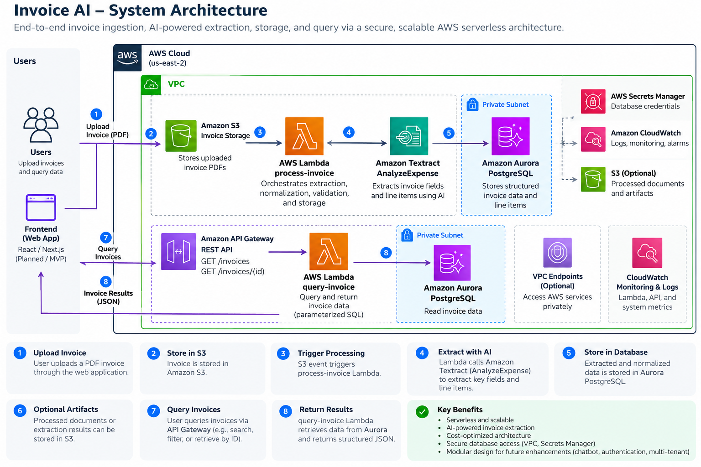

# AWS Invoice Intelligence

An AI-powered invoice processing platform built with Python and AWS serverless technologies.

## System Architecture

## Technologies

- AWS Lambda — Invoice processing and querying
- Amazon Textract — Invoice data extraction
- Amazon S3 — Document storage
- Amazon Aurora PostgreSQL — Structured invoice data
- Amazon API Gateway — HTTP API
- Amazon CloudWatch — Monitoring and logging

## Features

- Invoice PDF processing
- AI-powered field extraction
- Data normalization
- Duplicate invoice detection
- Invoice search and filtering

## Technical Documentation

See [Infrastructure Documentation](infrastructure/README.md) for additional architecture details.
